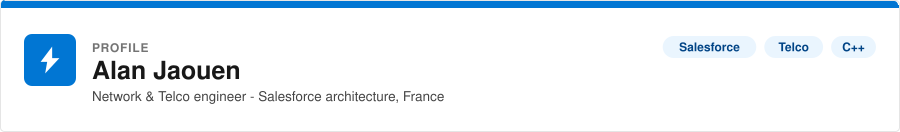
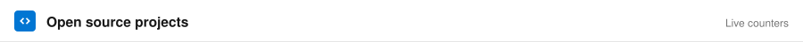
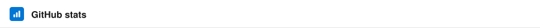
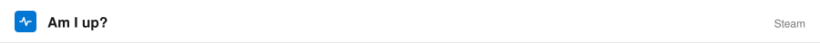

<picture>
  <source media="(prefers-color-scheme: dark)" srcset="img/slds/hero.dark.svg">
  
</picture>

  
  
  

<picture>
  <source media="(prefers-color-scheme: dark)" srcset="img/slds/card-about.dark.svg">
  
</picture>

- 🏢 Currently at [MeilleursAgents](https://www.meilleursagents.com/) (now part of [AVIV group](https://www.aviv-group.com/))
  - 💼 Leading 5+ developers toward state of the art tools & practices
  - 🏗️ Refactoring a monolithic Salesforce organisation into a modular one
- 🔭 Also working on [my ST3 plugin](https://packagecontrol.io/packages/Gitmoji)
- 💬 Ask me about **Telco, Networks, C++ or Salesforce**
- 🎓 Graduated from [EPITA](https://www.epita.fr/), [USPN](https://www.univ-spn.fr/) & [IUTV](https://iutv.univ-paris13.fr/)
- ⚡ Fun fact: top 0.1% player in [Destiny 2](https://destinytracker.com/destiny-2/profile/steam/4611686018471834151/overview)

<!-- - 📫 How to reach me **contact@alanjaouen.fr** -->
<!-- - 👨‍💻 All of my projects are available at [alanjaouen.fr](https://www.alanjaouen.fr/portfolio) -->

<picture>
  <source media="(prefers-color-scheme: dark)" srcset="img/slds/card-projects.dark.svg">
  
</picture>

| Project | Stars | Forks | Issues | Pull requests |
|---|---|---|---|---|
| [sublimeGitMoji](https://github.com/alanjaouen/sublimeGitMoji) |  |  |  |  |
| [SublimeLinter-apex](https://github.com/alanjaouen/SublimeLinter-apex) |  |  |  |  |

<picture>
  <source media="(prefers-color-scheme: dark)" srcset="img/slds/card-writing.dark.svg">
  
</picture>

Latest posts on [medium.com/@alan.jaouen.96](https://medium.com/@alan.jaouen.96):

<!-- BLOG-POST-LIST:START -->
<!-- BLOG-POST-LIST:END -->

<picture>
  <source media="(prefers-color-scheme: dark)" srcset="img/slds/card-tech.dark.svg">
  
</picture>

**Languages**

<picture>
  <source media="(prefers-color-scheme: dark)" srcset="img/slds/badges-langs.dark.svg">
  
</picture>

**Databases**

<picture>
  <source media="(prefers-color-scheme: dark)" srcset="img/slds/badges-db.dark.svg">
  
</picture>

<!--START_SECTION:waka-->
<!--END_SECTION:waka-->

<picture>
  <source media="(prefers-color-scheme: dark)" srcset="img/slds/card-stats.dark.svg">
  
</picture>

<table>
<tr>
<td width="33%"><picture><source media="(prefers-color-scheme: dark)" srcset="https://github-profile-summary-cards.vercel.app/api/cards/stats?username=alanjaouen&theme=github_dark"></picture></td>
<td width="33%"><picture><source media="(prefers-color-scheme: dark)" srcset="https://github-profile-summary-cards.vercel.app/api/cards/repos-per-language?username=alanjaouen&hide=Html&theme=github_dark"></picture></td>
<td width="33%"><picture><source media="(prefers-color-scheme: dark)" srcset="https://github-profile-summary-cards.vercel.app/api/cards/most-commit-language?username=alanjaouen&theme=github_dark"></picture></td>
</tr>
<tr>
<td colspan="3"><picture><source media="(prefers-color-scheme: dark)" srcset="https://github-profile-summary-cards.vercel.app/api/cards/profile-details?username=alanjaouen&theme=github_dark"></picture></td>
</tr>
<tr>
<td colspan="3"><picture><source media="(prefers-color-scheme: dark)" srcset="https://streak-stats.demolab.com?user=alanjaouen&date_format=M%20j%5B%2C%20Y%5D&border_radius=4&background=181818&border=2E2E2E&stroke=2E2E2E&ring=1B96FF&fire=FE9339&currStreakNum=F3F3F3&sideNums=F3F3F3&currStreakLabel=1B96FF&sideLabels=AEAEAE&dates=AEAEAE"></picture></td>
</tr>
</table>

<picture>
  <source media="(prefers-color-scheme: dark)" srcset="img/slds/card-activity.dark.svg">
  
</picture>

<picture>
  <source media="(prefers-color-scheme: dark)" srcset="img/slds/card-links.dark.svg">
  
</picture>

  
  
  
  

